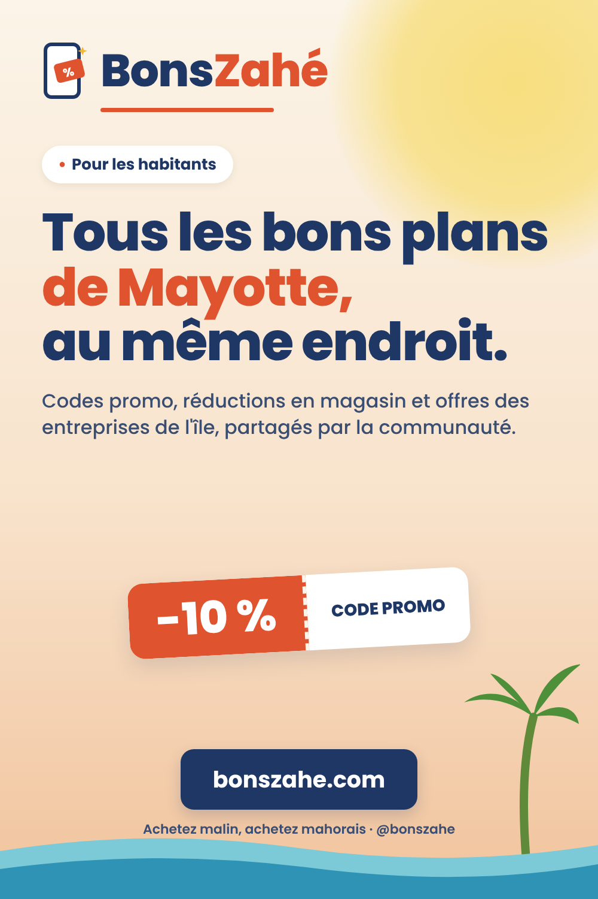
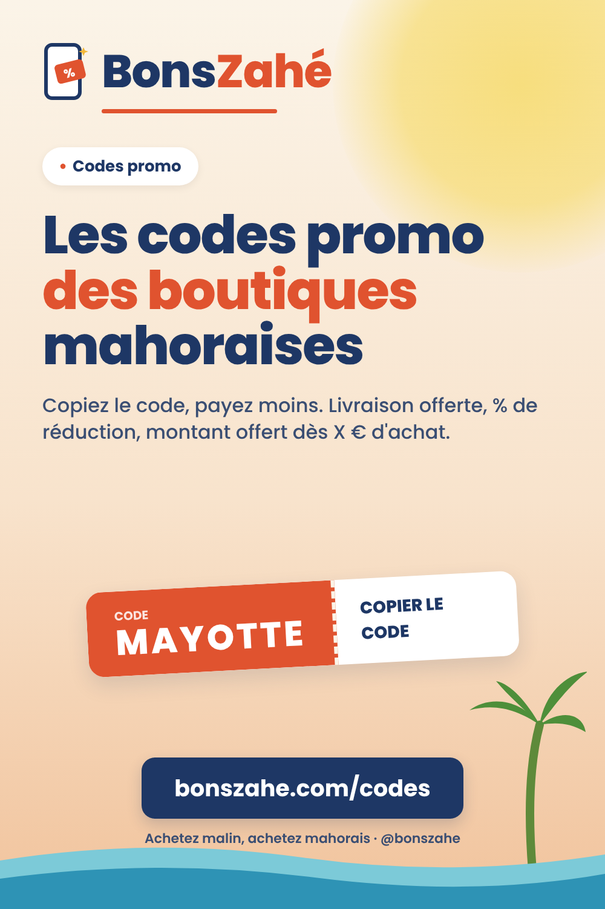
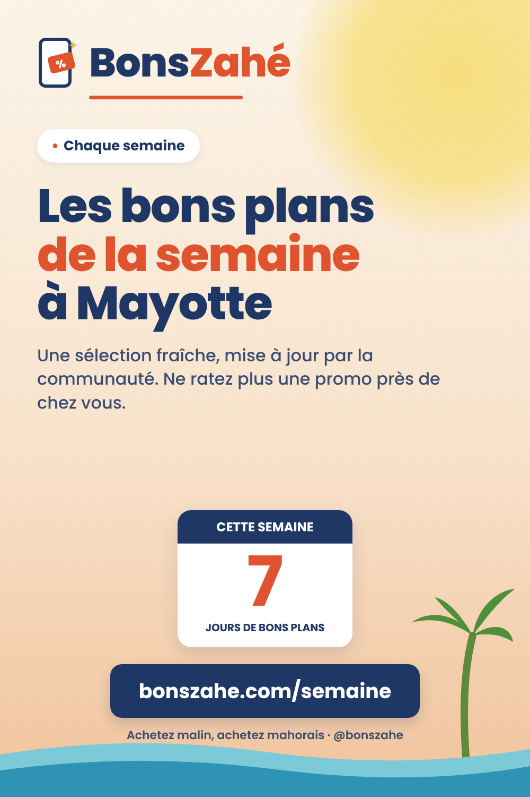
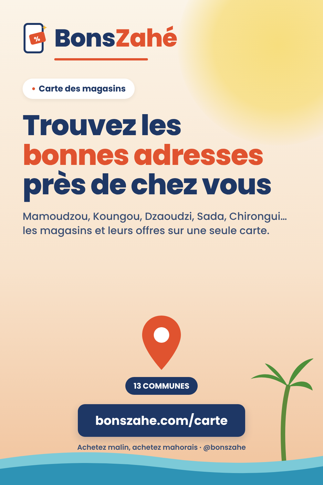
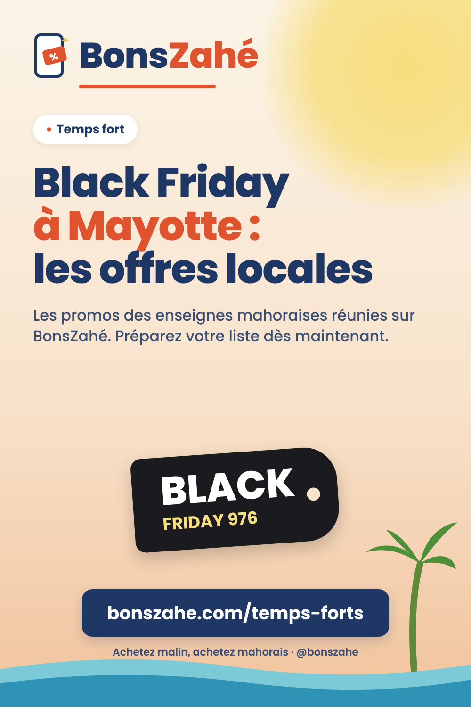
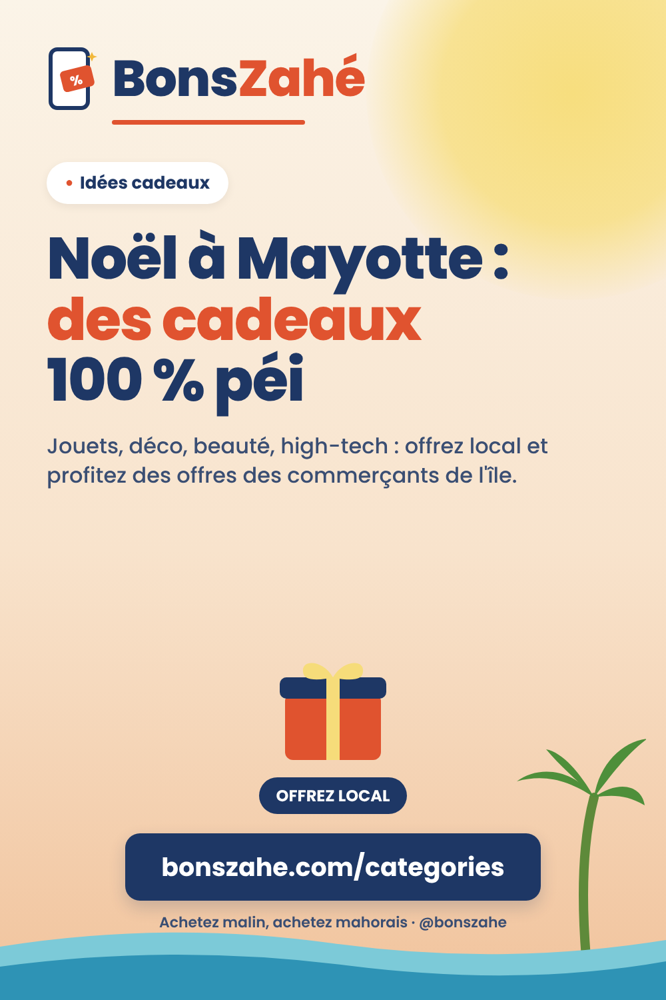
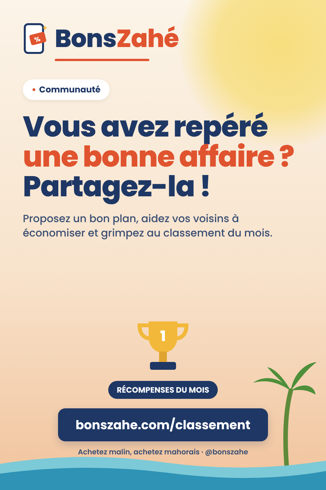
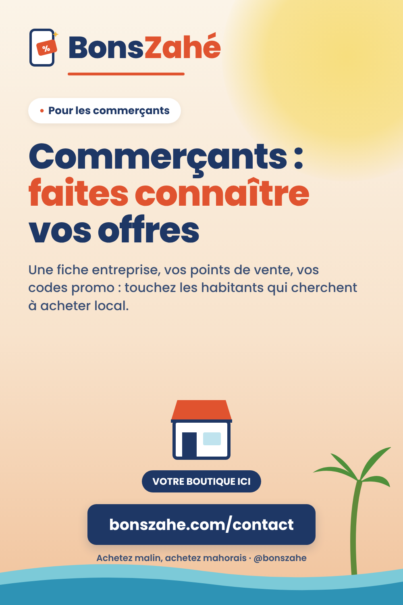

# Épingles Pinterest BonsZahé — à valider

Format 1000×1500 px. Images dans `images/`, textes ci-dessous. Pour modifier : éditer `pins.json` puis `node pinterest-bonszahe/generer.js`.

Tableaux à créer sur Pinterest : **Bons plans Mayotte**, **Commerçants mahorais**, **Astuces pour acheter malin**.

## 1. Bons plans Mayotte : codes promo et réductions au même endroit

- **Tableau** : Bons plans Mayotte
- **Lien** : https://www.bonszahe.com/
- **Titre** (62/100) : Bons plans Mayotte : codes promo et réductions au même endroit
- **Description** (292/500) : Envie d'acheter malin à Mayotte ? BonsZahé rassemble les codes promo, réductions en magasin et offres des entreprises mahoraises, partagés et vérifiés par la communauté. Shopping, beauté, maison, alimentation, restaurants… Achetez malin, achetez mahorais ! #Mayotte #BonsPlans #CodePromo #976

## 2. Codes promo Mayotte : toutes les réductions des boutiques mahoraises

- **Tableau** : Bons plans Mayotte
- **Lien** : https://www.bonszahe.com/codes
- **Titre** (68/100) : Codes promo Mayotte : toutes les réductions des boutiques mahoraises
- **Description** (251/500) : Retrouvez sur BonsZahé les codes promo des boutiques en ligne et magasins de Mayotte : pourcentages de réduction, livraison offerte, remises dès un montant d'achat. Un code à copier, un achat moins cher. #CodePromo #Mayotte #Réduction #ShoppingMayotte

## 3. Les bons plans de la semaine à Mayotte

- **Tableau** : Bons plans Mayotte
- **Lien** : https://www.bonszahe.com/semaine
- **Titre** (38/100) : Les bons plans de la semaine à Mayotte
- **Description** (216/500) : Chaque semaine, BonsZahé sélectionne les meilleures offres des entreprises de Mayotte : promos en magasin, codes en ligne, arrivages. Gardez cette épingle pour ne rien rater ! #BonsPlans #Mayotte #Promo #AcheterLocal

## 4. Carte des magasins de Mayotte et de leurs bons plans

- **Tableau** : Commerçants mahorais
- **Lien** : https://www.bonszahe.com/carte
- **Titre** (52/100) : Carte des magasins de Mayotte et de leurs bons plans
- **Description** (222/500) : Où acheter à Mayotte ? La carte BonsZahé réunit les magasins de l'île, de Mamoudzou à Kani-Kéli en passant par Koungou, Dzaoudzi, Sada ou Chirongui, avec leurs offres du moment. #Mayotte #Mamoudzou #Commerces #AcheterLocal

## 5. Black Friday Mayotte : les promos des enseignes locales

- **Tableau** : Bons plans Mayotte
- **Lien** : https://www.bonszahe.com/temps-forts
- **Titre** (55/100) : Black Friday Mayotte : les promos des enseignes locales
- **Description** (219/500) : Black Friday arrive ! Retrouvez sur BonsZahé les offres et codes promo des enseignes et boutiques de Mayotte. Comparez, sauvegardez vos favoris et achetez malin, achetez mahorais. #BlackFriday #Mayotte #Promo #BonsPlans

## 6. Idées cadeaux de Noël à Mayotte chez les commerçants locaux

- **Tableau** : Astuces pour acheter malin
- **Lien** : https://www.bonszahe.com/categories
- **Titre** (59/100) : Idées cadeaux de Noël à Mayotte chez les commerçants locaux
- **Description** (229/500) : Pour Noël, offrez local ! Jouets, décoration, beauté, high-tech, coffrets… Trouvez sur BonsZahé les entreprises de Mayotte par catégorie et leurs bons plans pour des cadeaux moins chers. #Noël #IdéesCadeaux #Mayotte #AcheterLocal

## 7. Partagez vos bons plans à Mayotte et gagnez des récompenses

- **Tableau** : Astuces pour acheter malin
- **Lien** : https://www.bonszahe.com/classement
- **Titre** (59/100) : Partagez vos bons plans à Mayotte et gagnez des récompenses
- **Description** (221/500) : BonsZahé, c'est une communauté : proposez les bons plans que vous repérez à Mayotte, aidez les habitants à économiser et apparaissez au classement et dans les récompenses du mois. #Communauté #Mayotte #BonsPlans #Entraide

## 8. Commerçants de Mayotte : mettez en avant vos offres sur BonsZahé

- **Tableau** : Commerçants mahorais
- **Lien** : https://www.bonszahe.com/contact
- **Titre** (64/100) : Commerçants de Mayotte : mettez en avant vos offres sur BonsZahé
- **Description** (237/500) : Vous êtes une entreprise à Mayotte ? Présentez votre activité, vos points de vente, la livraison et vos codes promo sur BonsZahé, la plateforme des bons plans mahorais. Contactez-nous ! #EntrepriseMayotte #Commerce #Mayotte #AcheterLocal
